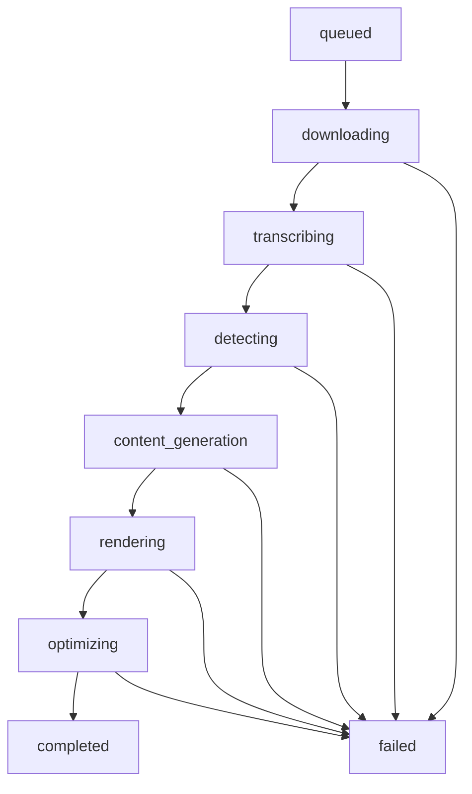

# AI Content Factory

AI Content Factory is a FastAPI pipeline that turns a YouTube URL into short-form vertical video assets for YouTube Shorts, Instagram Reels, TikTok, and Facebook Reels.

## Architecture

```mermaid
flowchart LR
  UI[Frontend] --> API[FastAPI]
  API --> Jobs[In-memory Job Store]
  API --> Pipeline[Pipeline Orchestrator]
  Pipeline --> Download[yt-dlp Download]
  Pipeline --> Whisper[faster-whisper]
  Pipeline --> Clips[LLM Clip Detection]
  Pipeline --> Pack[Content Pack]
  Pipeline --> Render[FFmpeg Clip Render]
  Pipeline --> Optimize[Vertical Optimizer]
  Pipeline --> Subs[Optional Subtitles]
  Pipeline --> Thumb[Thumbnail]
  Pipeline --> Static[/outputs and /downloads]
```

## Pipeline



## Setup

```bash
python -m venv .venv
.venv\Scripts\activate
pip install -r requirements.txt
copy .env.example .env
uvicorn app.main:app --reload
```

Install FFmpeg and FFprobe on PATH.

## Docker

```bash
docker compose up --build
```

The API will be available at `http://localhost:8000`.

## Environment Variables

See `.env.example` for the full list. Important settings:

- `GROQ_API_KEY`, `LLM_MODEL`
- `WHISPER_MODEL`, `WHISPER_DEVICE`, `WHISPER_COMPUTE_TYPE`
- `DOWNLOAD_DIR`, `OUTPUT_DIR`, `TEMP_DIR`
- `TARGET_WIDTH`, `TARGET_HEIGHT`, `VIDEO_CRF`, `VIDEO_PRESET`, `AUDIO_BITRATE`
- `ENABLE_SUBTITLES`, `ENABLE_THUMBNAILS`, `ENABLE_PLATFORM_EXPORTS`
- `CLIP_SELECTION_COUNT`
- `ENABLE_GPU`, `NVIDIA_ENCODER`, `CPU_ENCODER`
- `RETRY_ATTEMPTS`, `RETRY_INITIAL_DELAY_SECONDS`, `RETRY_BACKOFF_MULTIPLIER`
- `CLEANUP_*`

## API

Existing frontend-compatible endpoints are preserved:

- `GET /`
- `GET /health`
- `GET /ready`
- `GET /metrics`
- `POST /jobs`
- `GET /jobs/{job_id}`
- `POST /jobs/{job_id}/download`
- `POST /jobs/{job_id}/process`
- `POST /jobs/{job_id}/transcribe`
- `POST /jobs/{job_id}/detect-clips`
- `POST /jobs/{job_id}/render-clips`
- `POST /jobs/{job_id}/make-vertical`

Static assets:

- `/downloads/*`
- `/outputs/*`
- `/temp/*`

## Directory Structure

```text
app/
  ai/                 LLM, parsing, clip detection, transcription
  api/                FastAPI routes
  core/               storage and path helpers
  models/             job model and lifecycle state
  schemas/            request schemas
  services/           pipeline, FFmpeg, cleanup, subtitles, thumbnails, retries
frontend/             React UI
tests/                unit and integration tests
downloads/            raw videos, gitignored
outputs/              final clips/assets, gitignored
temp/                 intermediate files, gitignored
```

## Features

- Stable 9:16 FFmpeg rendering and optimization.
- Optional subtitle SRT generation and subtitle burn-in.
- Thumbnail generation with title overlay.
- Platform export preset metadata.
- Configurable top clip count.
- Hardware detection with safe CPU fallback.
- Retry/self-healing primitives with structured failure reports.
- Health, readiness, and metrics endpoints.
- Local storage abstraction ready for S3/R2/Azure implementation.
- Docker and GitHub Actions CI.

## Testing

```bash
python -m pytest -q
python -m ruff check app tests
python -m black --check app tests
```

CI runs install, Black, Ruff, Pytest, and Docker build validation hooks.

## Troubleshooting

- FFmpeg errors: verify `ffmpeg` and `ffprobe` are installed and on PATH.
- Groq errors: verify `GROQ_API_KEY` and `LLM_MODEL`.
- Slow transcription: use a smaller Whisper model or GPU settings.
- GPU unavailable: the app falls back to CPU automatically.
- Static 404: verify files exist under `downloads/` or `outputs/`.

## Production Notes

This project is production-ready for a single-node deployment. For higher scale, replace in-memory jobs with a database, move background work to a durable queue, and use object storage for generated assets.
