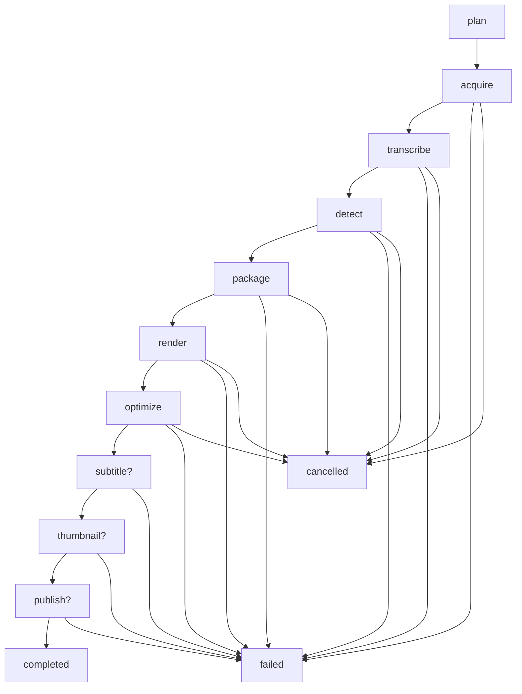

# AI Content Factory

AI Content Factory is a FastAPI pipeline that turns a YouTube URL into short-form vertical video assets for YouTube Shorts, Instagram Reels, TikTok, and Facebook Reels.

## Architecture

```mermaid
flowchart LR
  UI[Frontend - React + dark mode] --> API[FastAPI]
  API --> Jobs[(SQLite Job Store)]
  API --> Graph[Agent Graph - LangGraph]
  API --> Settings[Settings API]
  API --> Control[Job Control - retry/cancel/delete]
  Graph --> Download[yt-dlp Download]
  Graph --> Whisper[faster-whisper]
  Graph --> Clips[LLM Clip Detection]
  Graph --> Pack[Content Pack]
  Graph --> Render[FFmpeg Clip Render]
  Graph --> Optimize[Vertical Optimizer]
  Graph --> Subs[Optional Subtitles - SRT/VTT/ASS]
  Graph --> Thumb[Thumbnail Studio - Pillow templates]
  Graph --> Publish[YouTube Publishing - resumable upload]
  Graph --> Static[/outputs and /downloads]
```

## Pipeline

The pipeline runs as an explicit state machine (LangGraph). Optional stages are
routed around when they are disabled, and a cancel request is honoured at the
next stage boundary.



## Setup

```bash
python -m venv .venv
.venv\Scripts\activate
pip install -r requirements.txt
copy .env.example .env
uvicorn app.main:app --reload
```

Install FFmpeg and FFprobe on PATH.

## Docker

```bash
docker compose up --build
```

The API will be available at `http://localhost:8000`.

## Environment Variables

See `.env.example` for the full list. Important settings:

- `GROQ_API_KEY`, `LLM_MODEL`
- `WHISPER_MODEL`, `WHISPER_DEVICE`, `WHISPER_COMPUTE_TYPE`
- `DOWNLOAD_DIR`, `OUTPUT_DIR`, `TEMP_DIR`
- `TARGET_WIDTH`, `TARGET_HEIGHT`, `VIDEO_CRF`, `VIDEO_PRESET`, `AUDIO_BITRATE`
- `ENABLE_SUBTITLES`, `ENABLE_THUMBNAILS`, `ENABLE_PLATFORM_EXPORTS`
- `SUBTITLE_FORMAT` (`srt` | `vtt` | `ass`), `SUBTITLE_STYLE_*`
- `THUMBNAIL_TEMPLATE`, `THUMBNAIL_ACCENT_COLOR`, `THUMBNAIL_AI_ENDPOINT`
- `PIPELINE_ENGINE` (`graph` | `linear`)
- `YOUTUBE_CLIENT_ID`, `YOUTUBE_CLIENT_SECRET`, `YOUTUBE_REFRESH_TOKEN`,
  `YOUTUBE_DEFAULT_PRIVACY`, `YOUTUBE_PUBLISH_ENABLED`
- `CLIP_SELECTION_COUNT`
- `ENABLE_GPU`, `NVIDIA_ENCODER`, `CPU_ENCODER`
- `RETRY_ATTEMPTS`, `RETRY_INITIAL_DELAY_SECONDS`, `RETRY_BACKOFF_MULTIPLIER`
- `CLEANUP_*`

## API

Existing frontend-compatible endpoints are preserved:

- `GET /`
- `GET /health`
- `GET /ready`
- `GET /metrics`
- `POST /jobs`
- `GET /jobs/{job_id}`
- `POST /jobs/{job_id}/download`
- `POST /jobs/{job_id}/process`
- `POST /jobs/{job_id}/transcribe`
- `POST /jobs/{job_id}/detect-clips`
- `POST /jobs/{job_id}/render-clips`
- `POST /jobs/{job_id}/make-vertical`
- `POST /jobs/{job_id}/retry` — re-run a failed or cancelled job
- `POST /jobs/{job_id}/cancel` — stop at the next stage boundary
- `DELETE /jobs/{job_id}` — drop the job
- `POST /jobs/{job_id}/publish` — publish the rendered video to YouTube
- `GET /settings` — feature flags and limits (never secrets)

Static assets:

- `/downloads/*`
- `/outputs/*`
- `/temp/*`

## Publishing to YouTube

Create a Google Cloud project, enable the *YouTube Data API v3* and create an
OAuth client (desktop app). After the consent flow you receive a refresh
token. Put the credentials in `.env`:

```dotenv
YOUTUBE_CLIENT_ID="...apps.googleusercontent.com"
YOUTUBE_CLIENT_SECRET="..."
YOUTUBE_REFRESH_TOKEN="..."
YOUTUBE_DEFAULT_PRIVACY="private"
```

Then publish a rendered clip from the CLI (dry-run first - it validates the
metadata and the file without touching YouTube):

```bash
python scripts/publish.py --video outputs/<job>_vertical.mp4 \
  --title "5 facts about AI agents" \
  --description "Generated by the AI Content Factory" \
  --tags ai,shorts,automation --privacy unlisted --dry-run

python scripts/publish.py --video outputs/<job>_vertical.mp4 --privacy unlisted
```

Or through the API:

```bash
curl -X POST localhost:8000/jobs/<job_id>/publish \
  -H "Content-Type: application/json" \
  -d '{"privacy_status": "unlisted", "dry_run": true}'
```

The upload is a real resumable upload: the access token is refreshed from the
refresh token, a session is created for `snippet,status`, and the media is
sent in 8 MiB chunks. Failures are typed - `AuthError` (re-authorise),
`QuotaError` (daily limit) and `InvalidRequestError` (metadata) - so the API
can answer 401/429/400 instead of a generic 500.

### Getting the credentials (one-time, ~5 minutes)

You do not need to hunt for an old token - mint a new one:

1. [Google Cloud Console](https://console.cloud.google.com) -> create or pick a
   project -> **APIs & Services -> Library** -> enable **YouTube Data API v3**.
2. **Credentials -> Create credentials -> OAuth client ID -> Desktop app** ->
   copy the client id and client secret.
3. Run the helper (it opens the consent screen, captures the redirect and
   exchanges the code for a refresh token):

```bash
python scripts/youtube_authorize.py \
  --client-id "<id>" --client-secret "<secret>" --write-env
```

It writes the three values into `.env` (gitignored). Then confirm them with:

```bash
python scripts/publish.py --check
```

### Verifying without credentials

The upload path does not need a live YouTube account to prove itself:

```bash
python scripts/verify_publish.py
```

This starts a local server that speaks the YouTube Data API contract (OAuth
token exchange, resumable session, `308 Resume Incomplete`, the final
resource response) and drives the *real* publisher against it over HTTP - so
socket I/O, header handling, `Content-Range` semantics, resume behaviour and
response parsing are all exercised. Only the googleapis.com host itself is
left out.

The same stub runs as part of the test suite
(`tests/test_youtube_publisher_http.py`), including the error paths
(403 quota, 400 invalid request, 503 backend error).

Once you have credentials, check them without uploading anything:

```bash
python scripts/publish.py --check    # mints a token, uploads nothing
```

`YOUTUBE_API_BASE_URL` points the publisher at a different API host (the
stub, a proxy or a staging environment); leave it empty for the real Google
endpoints.

## Directory Structure

```text
app/
  agents/             LangGraph state machine + runner (linear fallback)
  ai/                 LLM, parsing, clip detection, transcription
  api/                FastAPI routes (jobs, settings)
  core/               storage, path helpers, cancellation
  models/             job model and lifecycle state
  schemas/            request schemas
  services/           pipeline, FFmpeg, cleanup, subtitles, thumbnails,
                      retries, YouTube publishing
frontend/             React UI (dark mode, job actions)
scripts/              publish.py - CLI for uploading a rendered video
tests/                unit and integration tests
downloads/            raw videos, gitignored
outputs/              final clips/assets, gitignored
temp/                 intermediate files, gitignored
```

## Features

- Stable 9:16 FFmpeg rendering and optimization.
- **LangGraph orchestration** with conditional stages and a linear fallback.
- **Real YouTube publishing** - OAuth2 refresh, resumable chunked upload,
  typed errors (auth / quota / invalid request) and a dry-run mode.
- Subtitles in **SRT, WebVTT and styled ASS**, with optional burn-in.
- **Thumbnail studio** - Pillow templates, safe zones and an optional
  AI-background provider.
- **Job control** - retry, cancel (cooperative) and delete.
- Settings API so the dashboard can adapt to the enabled features.
- React dashboard with dark mode and job actions.
- Platform export preset metadata.
- Configurable top clip count.
- Hardware detection with safe CPU fallback.
- Retry/self-healing primitives with structured failure reports.
- Health, readiness, and metrics endpoints.
- Local storage abstraction ready for S3/R2/Azure implementation.
- Docker and GitHub Actions CI (lint, tests, frontend build, image build).

## Testing

```bash
python -m pytest -q
python -m ruff check app tests
python -m black --check app tests
```

CI runs install, Black, Ruff, Pytest, and Docker build validation hooks.

## Troubleshooting

- FFmpeg errors: verify `ffmpeg` and `ffprobe` are installed and on PATH.
- Groq errors: verify `GROQ_API_KEY` and `LLM_MODEL`.
- Slow transcription: use a smaller Whisper model or GPU settings.
- GPU unavailable: the app falls back to CPU automatically.
- Static 404: verify files exist under `downloads/` or `outputs/`.

## Production Notes

This project is production-ready for a single-node deployment. For higher scale, replace in-memory jobs with a database, move background work to a durable queue, and use object storage for generated assets.
